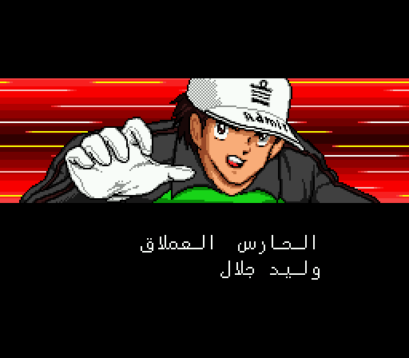
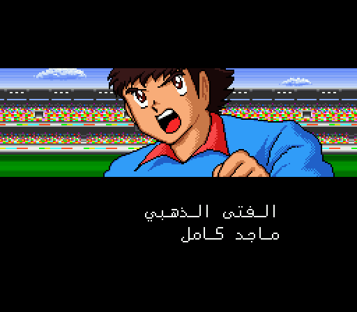
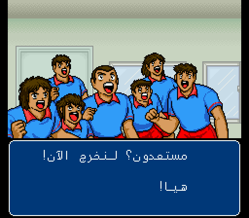
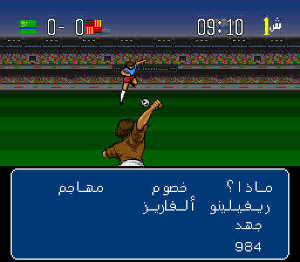
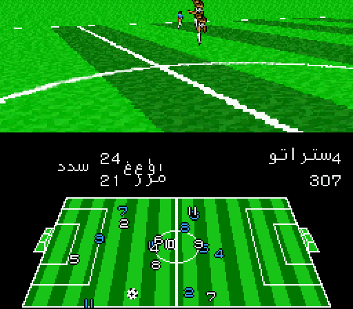
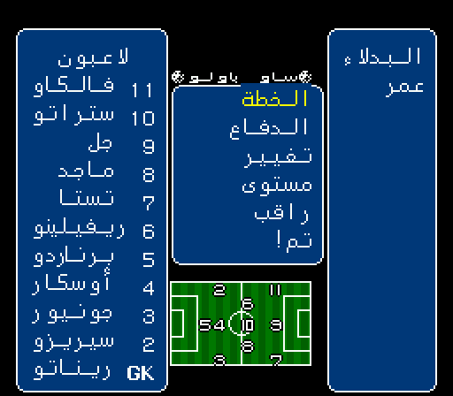
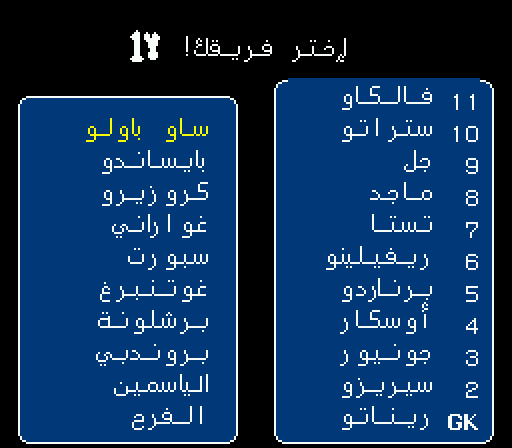
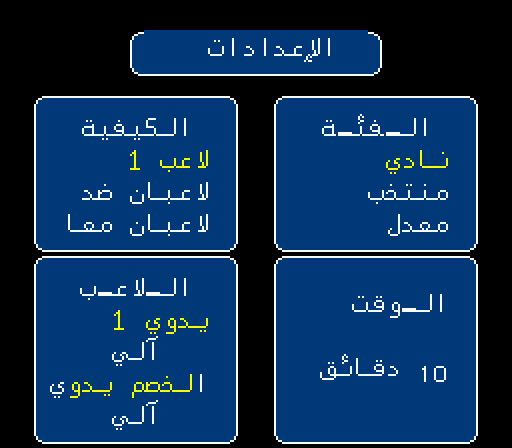
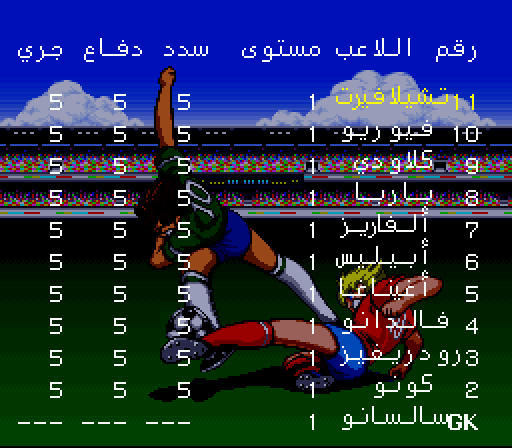

# Captain Tsubasa IV — Arabic

### الكابتن ماجد ٤ — الترجمة العربية

*Captain Tsubasa IV: Pro no Rival-tachi* (Super Famicom, Tecmo, 1994), in
Arabic. The story, every match, the menus, the stats screens, all 510 players,
85 teams and 165 special moves read right to left, in Arabic script, with the
letters joined — and the names are the ones you grew up with from
**الكابتن ماجد**.

The Arabic in the original v2.02 translation sat in the game's 8×8 font, one
cramped tile per letter. This version replaces it with a tall **8×16 font** and
a text engine that shapes each letter by its neighbours (initial, middle,
final, isolated, plus لا) and mirrors the boxes, menus and cursors so the
screens read the way Arabic does.

> **No ROM is included here.** You supply your own copy of the game. The
> download is a *patch* — a list of differences — and it does nothing without
> the original.

  
  

  
  
  
  
  
  
  
  

---

## What's in it

- **The whole script**, 4,800+ lines, reviewed against the Japanese and fitted
  to its boxes.
- **Names from the Arabic dub.** ماجد، وليد، بسام، مازن، مجد، ياسين… Long
  names get a short form where a box is narrow, so nothing is cut off.
- **A commentator in the style of رؤوف خليف.** Match calls, the between-halves
  lines and the idle chatter were rewritten in his voice — *أستر يا ستار*,
  *انتهى الدرس*, *يا سادة يا كرام*, *نار يا حبيبي نار*.
- **Proper commentary grammar.** «ماجد ينفذ الإعصار الخارق», «يسجل عن طريق
  تسديدة», and يووزع for an outfield player but يمرر for a goalkeeper.
- **An Arabic voice.** The pre-match shout is an Arabic voice-over —
  «مستعدون؟ مستعدون! هيا لنخرج الآن هيا!» — in place of Tsubasa's
  «よし いこう! いこうぜ みんな!!».
- **A new opening.** Each star is introduced with his nickname:
  الحارس العملاق، صقر الشمال، الأمير الزجاجي، النمر الضاري، الفنان، الفتى الذهبي.

---

## Playing it

**1. Get the patch.** `captain-tsubasa-4-arabic.bps`, from the
[latest release][releases].

**2. Get your ROM.** The original Japanese release, from your own cartridge or
your own backup:

| | |
|---|---|
| File | `Captain Tsubasa IV - Pro no Rival-tachi (Japan).sfc` |
| Size | 1,572,864 bytes (1.5 MiB, no copier header) |
| CRC32 | `3e04b246` |
| SHA-1 | `7471d2d4ea7c3e9fe2349b624c4ae570b585475f` |

The patch is made against the **untouched Japanese ROM**, not against an older
Arabic version. BPS stores a checksum of the ROM it expects, so the wrong base
gives you an error instead of a quietly broken game. If your file is
1,573,376 bytes it has a 512-byte copier header; remove it first.

**3. Apply it.**

- [Floating IPS (Flips)][flips] — Windows, macOS, Linux
- [RomPatcher.js][rompatcher] — runs in your browser, nothing to install
- `flips --apply captain-tsubasa-4-arabic.bps tsubasa4.sfc tsubasa4-arabic.sfc`

A correct result is 2,097,152 bytes (the game is expanded to 16 Mbit to make
room for the font and the voice).

**4. Play it** on anything accurate: [Mesen][mesen], [bsnes / higan][bsnes],
[Snes9x][snes9x], or a flashcart on real hardware.

> **Savestates from an older build** carry the old sound driver with them.
> Start from power-on or from an in-game save, not from an old savestate, or
> you may hear the Japanese voice instead of the Arabic one.

---

## Found something?

[Open an issue][issues] — a screenshot and roughly where you were is plenty.
Text that overruns its box, a letter in the wrong form, a name that should be
different, a line that reads awkwardly: all worth reporting, including the
last one. Translation notes are as welcome as bugs.

---

## Credits

Translation, font and engine work: **أيوب شكري** (Ayoub Chakri).

Built on the earlier Arabic translation **v2.02 by Megamanz** (CaptainMajed.com)
and the **Extra** team — شكر خاص لأحمد العراقي ومحسن ميجامانز.

Captain Tsubasa is © Yoichi Takahashi / Shueisha. *Captain Tsubasa IV: Pro no
Rival-tachi* is © Tecmo. This is an unofficial fan translation, not affiliated
with or endorsed by them.

[flips]: https://github.com/Alcaro/Flips
[rompatcher]: https://www.marcrobledo.com/RomPatcher.js/
[mesen]: https://www.mesen.ca/
[bsnes]: https://github.com/bsnes-emu/bsnes
[snes9x]: https://www.snes9x.com/
[releases]: https://github.com/SherlockedMain/Captain_Tsubasa_IV_Arabic/releases/latest
[issues]: https://github.com/SherlockedMain/Captain_Tsubasa_IV_Arabic/issues
